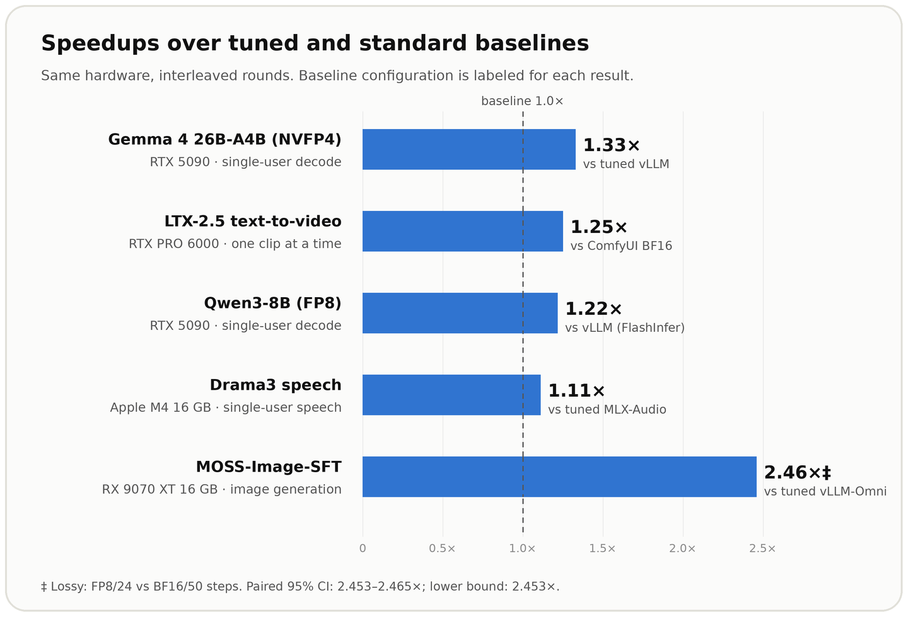

<div align="center">

# inferencekit-engines

**The fastest engines across models and hardware.**

The community-maintained repo of the best inference engines for any model and hardware.

[](LICENSE)
[](#engines)
[](#engines)
[](https://github.com/kittenml/inferencekit)

[Run one](#run-one) · [Engines](#engines) · [How they are made](#how-they-are-made) · [Add your engine](#add-your-engine) · [inferencekit](https://github.com/kittenml/inferencekit) · [Discord](https://discord.com/invite/VJ86W4SURW)

</div>

Each engine lives in a `<model>_<hardware>` folder with its own requirements, implementation and evidence. These are contributed configurations across language, video, speech and image models; results apply to the stated hardware, baseline and quality settings. Contributions for more models and hardware are welcome.

## Run one

Read the selected engine's requirements first. For [Gemma 4 on RTX 5090](gemma-4-26b-a4b-nvfp4_rtx-5090/):

```bash
git clone https://github.com/kittenml/inferencekit-engines
cd inferencekit-engines/gemma-4-26b-a4b-nvfp4_rtx-5090
./install.sh      # builds ./.venv inside the folder, no root needed
./serve.sh        # OpenAI-compatible server on port 8000
```

Then run `./test.sh` in a second terminal to print one reply. The LTX folder saves one clip instead, and its install asks you to log in to Hugging Face because the model is gated. For Drama3, follow the [MAIN5/Tower5 build and serving instructions](drama-3_apple-m4-16gb/profiles/main5-tower5/README.md).

<a id="engines"></a>

## Showcase

**Baseline selection includes competing engines:** Gemma's tuned vLLM baseline followed a vLLM/SGLang screen; LTX's ComfyUI baseline was fastest in the tested ComfyUI, Diffusers and official LTX pipeline screen.

### Gemma 4: faster decode on RTX 5090

Claude Opus 5.5 used inferencekit to build an exact sampler, batch-1 NVFP4 MoE kernels, a pruned output layer and lossless BF16 weight packing. **1.33× faster single-user decode than tuned vLLM**, with the same NVFP4 weights and activation scheme.

[Run the engine](gemma-4-26b-a4b-nvfp4_rtx-5090/) · [What the agent changed](gemma-4-26b-a4b-nvfp4_rtx-5090/README.md#how-it-was-made)

### LTX-2.5: faster video generation on RTX PRO 6000

Claude Opus 5.5 used inferencekit to compile transformer blocks, fuse kernels and reuse work between guidance passes. **1.25× faster than ComfyUI** for one 768 × 512, 121-frame clip at a time, with the same BF16 weights and 30 steps; quality checks passed, but outputs are not bit-identical.

[Run the engine](ltx-2.5_rtx-pro-6000/) · [What the agent changed](ltx-2.5_rtx-pro-6000/README.md#how-it-was-made)

### Drama3: speech optimization on Apple M4 (16 GB)

GPT-6.1 Sol used inferencekit to remove a redundant sampler sort, compile single-token GDN blocks and release the codec encoder after reference preparation. **1.112× faster single-user speech generation than the MLX-Audio baseline selected from the tested configurations**, on identical quantized weights. Output-preservation checks passed for all 144 paired outputs, matching audio, codes, chunks and completion. Neither engine met every-request realtime playback.

[Run the MAIN5/Tower5 profile](drama-3_apple-m4-16gb/profiles/main5-tower5/README.md) · [What the agent changed](drama-3_apple-m4-16gb/README.md#how-it-was-made)

### MOSS-Image-SFT: an accepted speed/quality trade-off on AMD

GPT-6.1 Terra used inferencekit to integrate online FP8 into selected transformer projections and tune the quantization scale and step count. **2.46× faster than the tested tuned vLLM-Omni baseline** on a 16 GB RX 9070 XT: FP8/24 steps versus BF16/50 steps, with quality secondary. The development configuration was measured; standalone package installation and launch have not been GPU-validated.

[Package and validation status](moss-image-sft_rx-9070-xt-fp8/) · [What the agent changed](moss-image-sft_rx-9070-xt-fp8/README.md#how-it-was-made)

### Qwen3-8B on RTX 5090: 1.22× faster single-user decode than vLLM with FlashInfer

**Fastest decode in our tested vLLM, SGLang and llama.cpp panel.** Claude Opus 5.5 used inferencekit to build a custom engine on RTX 5090 with FP8 matrix-vector kernels, a CUDA graph for the decode step and fused attention. Single-user decode was measured with in-process timers and no speculative decoding; llama.cpp Q8_0 is a separate format comparison.

[Run the engine](qwen3-8b-fp8_rtx-5090/) · [What the agent changed](qwen3-8b-fp8_rtx-5090/README.md#how-it-was-made)



<details>
<summary>Engine index and measurement details</summary>

| Folder | Model | Hardware | Speedup | Built with |
|---|---|---|---|---|
| [`gemma-4-26b-a4b-nvfp4_rtx-5090`](gemma-4-26b-a4b-nvfp4_rtx-5090/) | Gemma 4 26B-A4B, NVFP4 | RTX 5090 | **1.33×** vs tuned vLLM | Claude Opus 5.5 (high) |
| [`ltx-2.5_rtx-pro-6000`](ltx-2.5_rtx-pro-6000/) | LTX-2.5 text-to-video | RTX PRO 6000 | **1.25×** vs ComfyUI | Claude Opus 5.5 (high) |
| [`qwen3-8b-fp8_rtx-5090`](qwen3-8b-fp8_rtx-5090/) | Qwen3-8B, FP8 | RTX 5090 | **1.22×** vs vLLM with FlashInfer | Claude Opus 5.5 (xhigh) |
| [`drama-3_apple-m4-16gb`](drama-3_apple-m4-16gb/)† | Drama3 speech, quantized | Apple M4, 16 GB | **1.112×** vs tuned MLX-Audio | GPT-6.1 Sol (high) |
| [`moss-image-sft_rx-9070-xt-fp8`](moss-image-sft_rx-9070-xt-fp8/)‡ | MOSS-Image-SFT, FP8 | RX 9070 XT, 16 GB | **2.46×** vs tuned vLLM-Omni | GPT-6.1 Terra (high) |

<sub>Qwen3-8B is compared against vLLM 0.31.0 with FlashInfer attention; neither side uses speculative decoding. † Drama3 uses identical quantized weights and matched PCM audio, codes, chunks and completion in 144 fresh output pairs; four timing rounds gave a 95% CI of 1.059×–1.156×. [Comparison details](drama-3_apple-m4-16gb/profiles/main5-tower5/QUALIFIED_COMPARISON_V65.json). How each engine was measured and how to reproduce it: its folder's README.</sub>

<sub>‡ Lossy speed-first experiment: FP8/24 steps vs BF16/50 steps; paired 95% CI **2.453–2.465×**, conservative lower bound **2.453×**. [Outputs, timing and accounting](moss-image-sft_rx-9070-xt-fp8/).</sub>

</details>

**KittenML models:** Kitten TTS 2 delivers **about 5–7× faster complete-audio generation than vLLM and llama.cpp on RTX PRO 6000** in our tested configurations. Follow our ongoing inferencekit optimization work on Kitten TTS 0.8 and Kitten TTS 2 in [Kitten Inference](https://github.com/KittenML/kitten-inference), where the native implementations and benchmarks are maintained.

## How they are made

These engines were built with [inferencekit](https://github.com/kittenml/inferencekit), which guides the agent through baseline tuning, profiling, implementation and quality checks. Each model README links its `REPORT.md` with the results, run commands, optimizations and supporting evidence.

<details>
<summary>Agent time, tokens and cost</summary>

| Engine | Agent time | Tokens | Cost at API list price |
|---|---|---|---|
| Gemma 4 26B-A4B | 19 h | 630M | $199 |
| LTX-2.5 | 3.6 h | 47M | $18 |
| Qwen3-8B | about 10 h | about 240M | about $125 |
| Drama3 | ~70 h elapsed | ~2.07B | ~$475 standard-rate equivalent |
| MOSS-Image-SFT | ~19.6 h elapsed | ~1.80B | ~$206 standard-rate equivalent |

Time and tokens include setup, benchmarking, optimization, validation and reporting. Costs are API list-price estimates; most tokens are cached conversation reads. Drama3’s estimates cover direct agent work ([accounting](drama-3_apple-m4-16gb/ACCOUNTING_V65.json)).

</details>

**How we measure:** each engine and its baseline run on the same hardware, one at a time, in interleaved rounds, with quality checks described in each engine’s evidence. Each folder's README says how its number was timed and gives the command to reproduce it.

## Add your engine

Anyone can contribute. Your engine must beat a tuned baseline on the same hardware and pass the inferencekit checks: the anti-cheat gates (`inferencekit gates run`) and quality against a reference model. Read [CONTRIBUTING.md](CONTRIBUTING.md) for the folder template.

## Coming next

More hardware (H100, H200, B200, RTX 4090, Intel GPUs, Jetson), more models and modalities, and engines for many users at once.

## License

Apache-2.0, except [`ltx-2.5_rtx-pro-6000/`](ltx-2.5_rtx-pro-6000/), which ships under the LTX-2.x Community License. Third-party code retains the licenses recorded in each package. Drama3 model weights, conversions and reference assets are subject to the [Fish Audio Community License](drama-3_apple-m4-16gb/licenses/FISH_AUDIO_COMMUNITY_LICENSE.txt). Copyright 2026 Stellon Labs. Model names belong to their owners.
