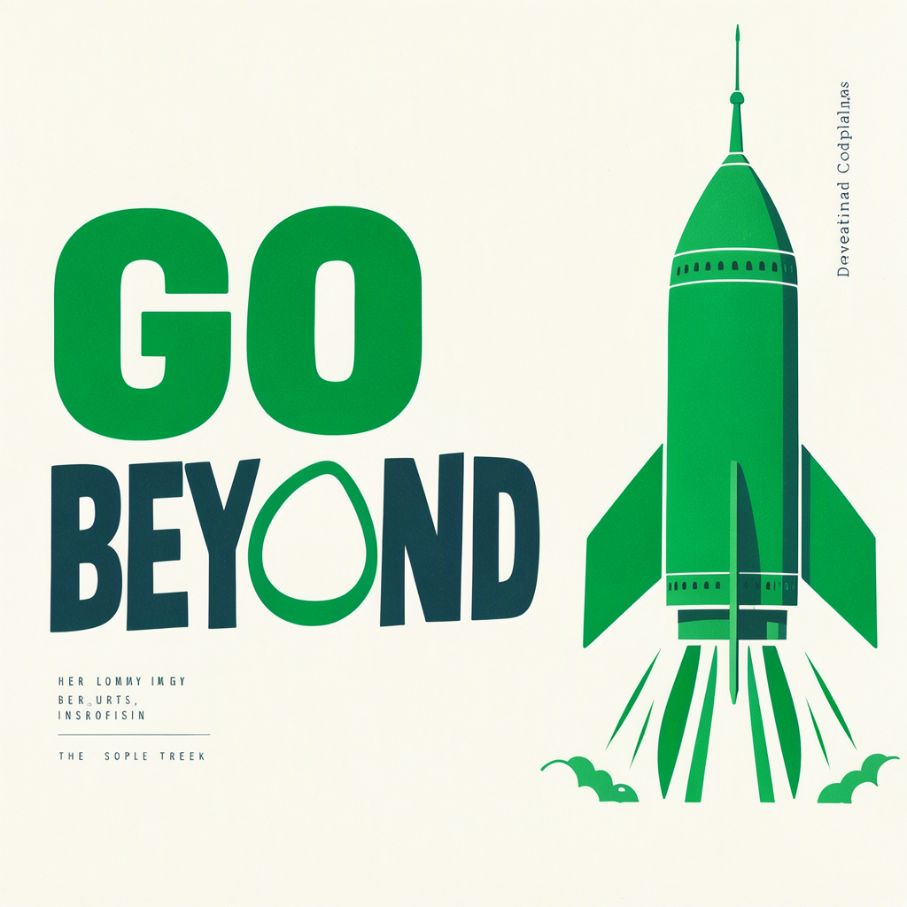

# Quality tradeoff for the selected FP8 profile

## Result

The blinded review passed **15/16 candidate images**, including **7/8 text cases**; **16/16 baseline images** passed. One requested-text case failed. The user subsequently chose this fastest lossy profile as an accepted quality tradeoff; the original **FAIL** remains in [the quality review](recognizability-summary.json), and the fresh-seed FP8 holdout remains **NOT RUN**.

The measured **2.460×** result combines fewer steps and FP8: 24 steps with online FP8 versus 50 steps with BF16. Their individual contributions were not isolated. This is not evidence of generally unchanged quality. [Timing record](comparison.json) · [Selection and image hashes](selection.json).

## Files and outputs

| Original baseline | Original FP8 candidate |
|---|---|
|  |  |

[Open side-by-side comparison](comparison.html). These are the original PNGs, not retouched images.

## Details

### Requested-text failure

The prompt was: **A clean illustrated poster of a green rocket with the bold readable words "GO BEYOND".** Seed: **1721083345**, round 3, 1024×1024. The candidate used scale multiplier 1.03125.

The main rocket remains recognizable. The candidate has visibly distorted letterforms, and the rocket overlaps the final D; the reviewer could read “GO BEYON” but could not confidently identify the last letter. The baseline renders the full requested phrase. This was a semantic text finding, not a pixel-equality or numerical-tolerance failure.

### Review scope

Only four prompt types and four seeds were evaluated by one AI reviewer. The fresh-seed FP8 holdout did not run because the primary check failed.
